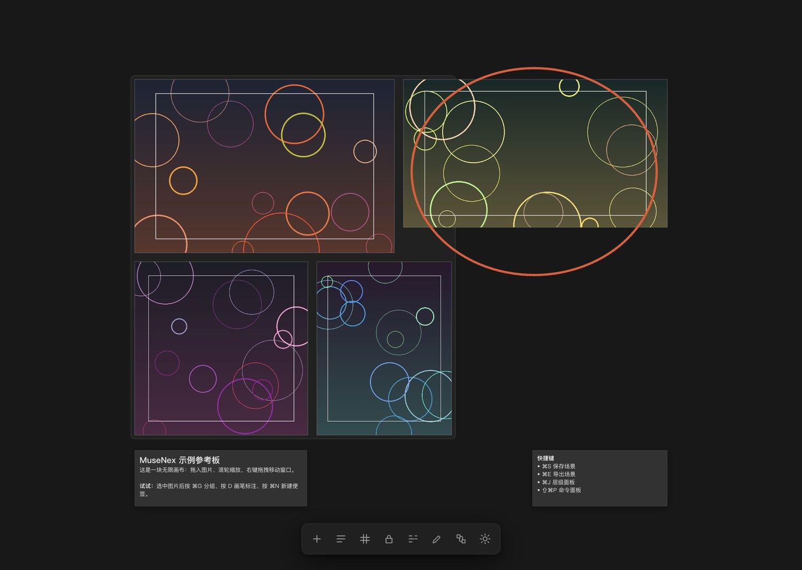
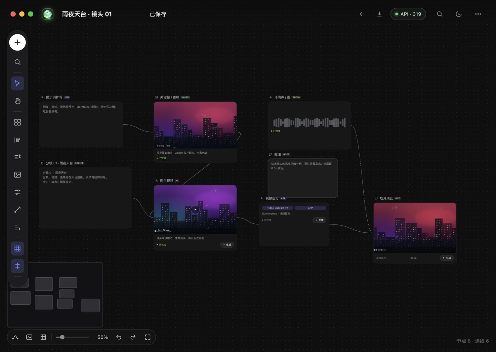
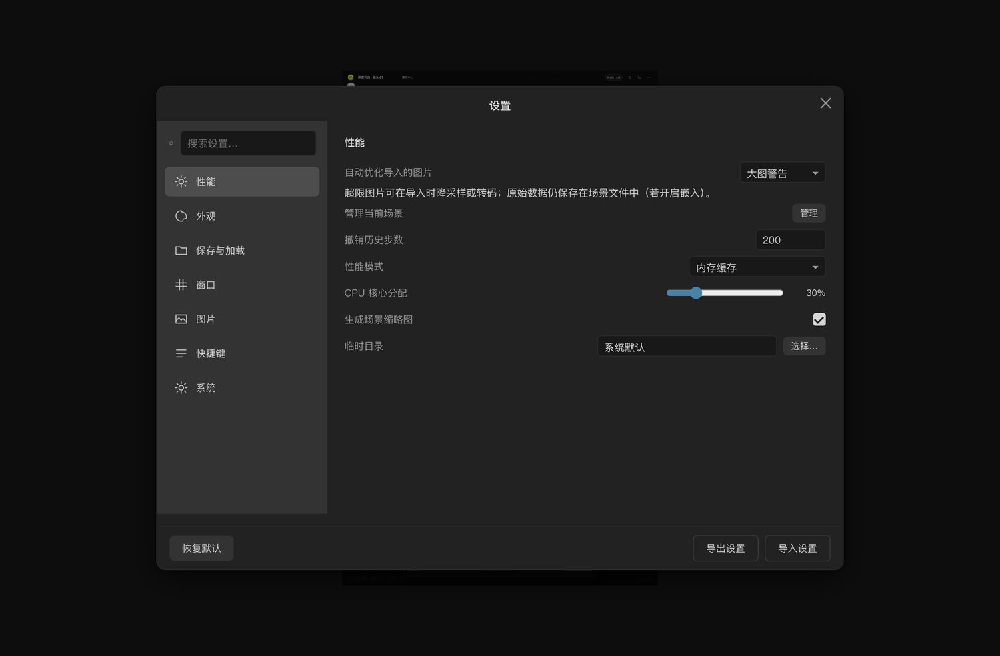
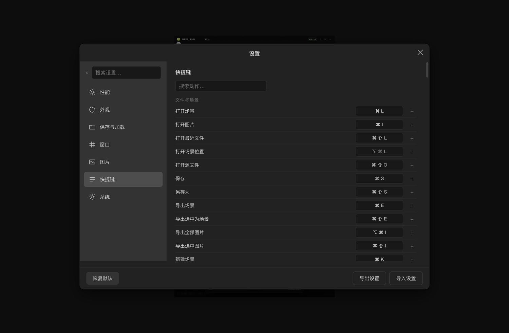
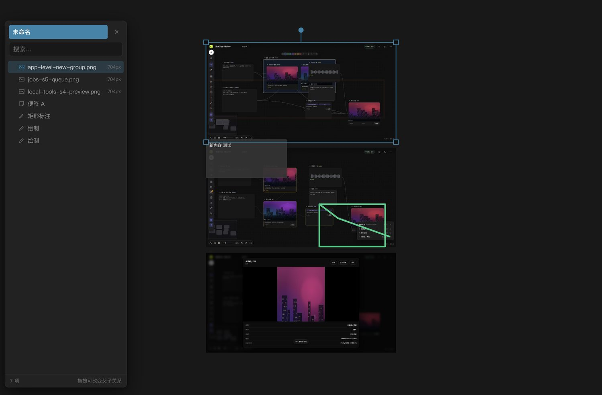
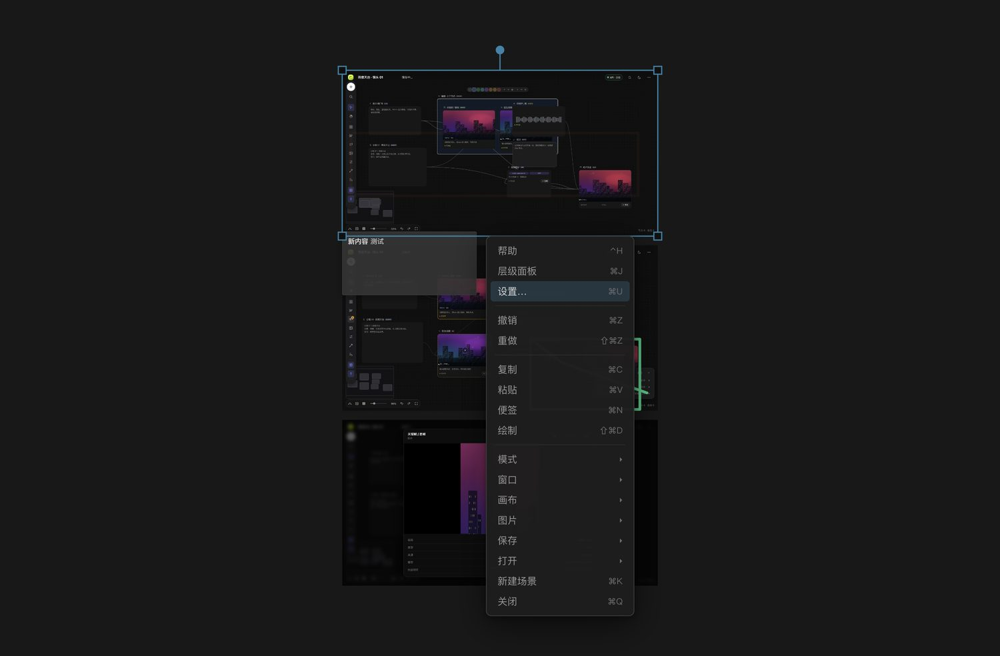
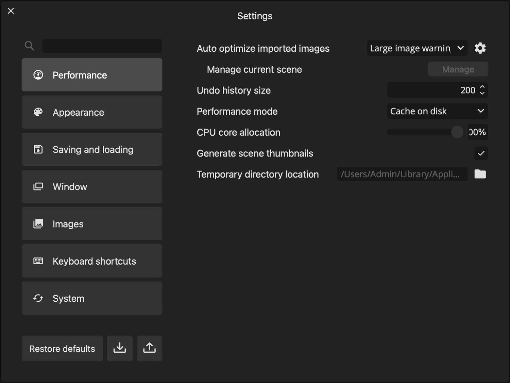
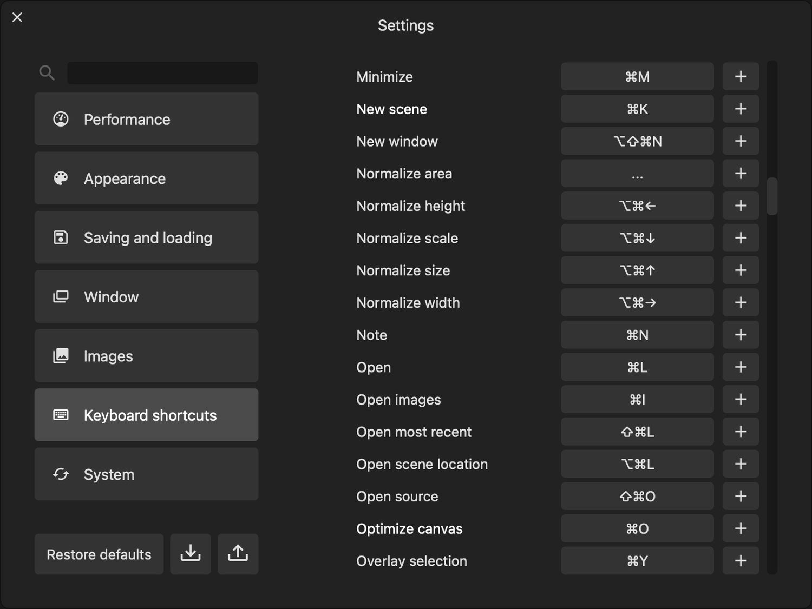

# MuseNex

[](LICENSE)

本地离线的**双工作区创作画布**，一个应用、两个工作区：

| 工作区 | 快捷键 | 内容 |
| --- | --- | --- |
| **参考板** | `⌘1` | PureRef 风格的无限图片画布：拖图、缩放、排列、分组、标注、保存、导出 |
| **无限画布** | `⌘2` | 节点式 AI 工作流画布（由 `infinite-canvas` 工程构建），与参考板图片互发 |

- 参考板依据 **PureRef 2.1.3** 的逆向规格重建；
- 无限画布来自对 runninghub 画布的逆向重建工程；
- 全程本地运行：无登录、无授权、无遥测、无联网更新（画布的 AI 生成除外，需自行配置 API）。

> **English**：MuseNex is a local-first, dual-workspace creative canvas for macOS, built on Electron
> with zero third-party runtime dependencies. **Board** (`⌘1`) is a PureRef-style infinite reference
> board rebuilt from a reverse-engineered feature spec; **Infinite Canvas** (`⌘2`) is a node-based AI
> workflow canvas. Images can be sent between the two workspaces. No login, telemetry or online
> activation; only AI generation nodes require your own APIMart-compatible API key.

---

## 交付物与目录

```
MuseNex/
├── .runtime/MuseNex.app     ← 构建用 Electron 运行时（隐藏目录，不参与 Spotlight/启动台搜索）
├── muse.config.json         ← 应用与工作区清单（框架入口）
├── package.json             ← 根工程脚本（dev / build / install / check）
├── shell/                   ← 统一 Electron 外壳
│   ├── main.js              ← 窗口、工作区注册/切换、协议、菜单、IPC、场景容器
│   ├── preload-main.js      ← 参考板桥接（window.musenex）
│   └── preload-view.js      ← 视图工作区桥接（窗口按钮、主题、图片互传、边缘缩放）
├── PureRef-CYQ/             ← 参考板工作区：代码 + 算法
│   ├── renderer/            ← 画布/交互/界面/数据模型
│   ├── ALGORITHM.md         ← 算法与扩展约定
│   └── package.json
├── infinite-canvas/         ← 无限画布工作区：源码 + 算法 + 构建产物
│   ├── src/                 ← 画布引擎、节点模型、UI、API
│   ├── dist/                ← 单文件构建产物（MuseNex 实际加载）
│   ├── WORKSPACE.md         ← 代码与桥接说明
│   └── server.mjs / build.mjs / tests/
├── assets/                  ← 图标源文件
├── examples/                ← 示例场景与示例图片
├── docs/                    ← 规格、证据、架构、融合说明、截图
├── scripts/                 ← dev.command / build-app.mjs / bootstrap-runtime.mjs / install.sh / check.mjs
├── 00-target/               ← 被逆向的 PureRef 原版样本（143MB，仅留档，可删）
└── README.md
```

---

## 快速开始

**已安装：** `/Applications/MuseNex.app`（macOS arm64，ad-hoc 签名；这是唯一会被搜索/启动台收录的副本）。
在「应用程序」或 `⌘Space` 搜 “MuseNex” 打开；若提示无法验证开发者，右键 → 打开。

1. 参考板里拖入图片，或双击 `examples/示例场景.prcyq` 打开示例；
2. 按 `⌘2` 进入无限画布，`⌘1` 返回；
3. 选中参考板图片 → 工具栏「发送到…」把图片送进画布节点；
4. 画布选中图片节点 → 右上角 `⤓` 把图片取回参考板。

数据位置：`~/Library/Application Support/MuseNex/`
（`settings.json` 设置、`autosave.prcyq` 自动保存、`canvas-config.json` 画布 API 配置）。
删除该目录可恢复出厂状态。

---

## 开发与构建

```bash
git clone https://github.com/CYQ131515/MuseNex.git
cd MuseNex

# 首次需要准备 Electron 运行时（约 280MB，不提交到仓库；自动下载，可用 ELECTRON_ZIP 指定本地 zip）
node scripts/bootstrap-runtime.mjs

# 开发（源码即时生效，独立数据目录 + CDP 9222）
./scripts/dev.command

# 重建 Resources/app 并签名（运行时复用 .runtime/MuseNex.app）
node scripts/build-app.mjs

# 构建 + 安装到 /Applications 并启动
./scripts/install.sh

# 基础检查（manifest、入口、preload、JS 语法）
node scripts/check.mjs
```

运行时说明：`.runtime/MuseNex.app` 是重命名后的 Electron 运行时（隐藏、不提交；首次构建会自动下载
`electron-v43.7.9-darwin-arm64.zip` 并改名，也可用 `ELECTRON_ZIP` 指定本地 zip）；构建只替换其
`Contents/Resources/app` 与图标，不复制 300MB 框架。开发模式用
`.runtime/MuseNex.app/Contents/MacOS/MuseNex <仓库根>` 直接以仓库为 app 入口。

---

## 工作区框架（方便继续加功能）

`muse.config.json` 是唯一的工作区注册表：

```json
{
  "mainWorkspace": "board",
  "workspaces": [
    { "id": "board", "kind": "main", "dir": "PureRef-CYQ", "entry": "renderer/index.html",
      "preload": "shell/preload-main.js", "name": "参考板", "shortcut": "CommandOrControl+1" },
    { "id": "canvas", "kind": "view", "dir": "infinite-canvas", "webRoot": "dist",
      "entry": "infinite-canvas.html", "preload": "shell/preload-view.js", "name": "无限画布",
      "shortcut": "CommandOrControl+2", "capabilities": ["addImages","pullImages"],
      "apiProxy": { "configFile": "canvas-config.json", "baseUrlDefault": "https://api.apimart.ai/v1" } }
  ]
}
```

- **主工作区**（`kind: "main"`）：作为 BrowserWindow 主页面，拥有完整菜单与设置；
- **视图工作区**（`kind: "view"`）：以 `WebContentsView` + 自定义协议 `musenex://<id>/...` 加载，
  自动获得窗口按钮、主题同步、图片互传与边缘缩放；
- 菜单「工作区」、`⌘1/⌘2`、参考板工具栏都由这份清单自动生成；
- `capabilities` 声明桥能力：`addImages`（接收参考板图片）/ `pullImages`（把选中图片送回参考板）；
- `apiProxy` 让工作区的 `/api/*` 由主进程代理，密钥只读本机配置文件，不进网页。

**新增一个工作区**：建目录（代码 + 算法 + 构建产物）→ 在 `muse.config.json` 加一条 →
如需独立 preload 就放 `shell/` → `node scripts/check.mjs && node scripts/build-app.mjs`。
详见 [docs/架构说明.md](docs/架构说明.md)。

**新增参考板功能**：`PureRef-CYQ/renderer/store.js`（模型/算法）→ `ui.js`（界面/动作）→
`i18n.js`（动作与快捷键）→ 见 [PureRef-CYQ/ALGORITHM.md](PureRef-CYQ/ALGORITHM.md)。

**更新无限画布**：在 `infinite-canvas` 执行 `node build.mjs`，覆盖 `dist/` 后重新构建安装；
见 [infinite-canvas/WORKSPACE.md](infinite-canvas/WORKSPACE.md)。

---

## 界面预览

示例参考板：



无限画布工作区：



| 设置 | 快捷键 |
| --- | --- |
|  |  |

| 层级面板 | 右键菜单 |
| --- | --- |
|  |  |

原版 PureRef 对照（规格核对用）：

| 原版设置 | 原版快捷键表 |
| --- | --- |
|  |  |

---

## 功能总览（参考板）

**画布**：无限大画布、指针锚定缩放（`⌘+`/`⌘-`/`⌘0`）、中键/空格拖拽平移、适应全部、双击聚焦、
网格（无/线/点 + 吸附）、画布灰度、画布锁定、窗口缩放时缩放场景。

**图片**：PNG/JPEG/GIF/WebP/BMP/TIFF/SVG/HEIC；多选拖动、等比缩放、旋转、翻转、不透明度、
非破坏裁剪与重置、双线性/最近邻、灰度、锁定、置顶置底、注释、替换、重新链接、
剪贴板粘贴、拖入 URL、动图播放。

**便签**：新建（`⌘N`）、加粗/斜体/下划线/删除线、字号字体、文字/高亮/背景色、
项目符号/编号/待办、缩进、四种对齐、链接、格式复制粘贴、自动尺寸、两种样式。

**绘制**：画笔 `D`、直线 `L`、椭圆 `C`、矩形 `R`、橡皮 `E`；三档线宽；实线/点线/箭头；
取色器；`⇧` 约束；`Esc` 取消。

**组织与布局**：框选/加选、分组/解组/父级、层级面板拖拽、对齐 4 向、堆叠、分布 2 向、
统一尺寸 5 种、自动排列 6 种、吸附参考线。

**保存与导出**：`.prcyq` 单文件（可嵌图/仅链接）、自动保存与崩溃恢复、最近文件缩略图、
导出场景/选中为 PNG/JPEG/WebP、批量导出图片（格式/裁剪/命名模板）。

**窗口**：无边框 + 悬停标题栏、右键拖拽移动、边缘缩放、置顶、锁定窗口、缩放到选择、
整体不透明度、鼠标穿透、最大化/最小化、多窗口。

**其它**：命令面板（`⇧⌘P`/`F3`）、7 页设置、快捷键可视化重绑、暗/亮/玻璃主题、
颜色自定义、帮助浮层（`⌃H`）、右键菜单、Toast。

---

## 快捷键速查

| 操作 | 按键 |
| --- | --- |
| 参考板 / 无限画布 | `⌘1` / `⌘2` |
| 打开图片 / 场景 | `⌘I` / `⌘L` |
| 保存 / 另存为 | `⌘S` / `⇧⌘S` |
| 导出场景 / 批量图片 | `⌘E` / `⌥⌘I` |
| 撤销 / 重做 | `⌘Z` / `⇧⌘Z` |
| 复制 / 剪切 / 粘贴 | `⌘C` / `⌘X` / `⌘V` |
| 全选 / 删除 | `⌘A` / `⌫` |
| 新建场景 / 便签 | `⌘K` / `⌘N` |
| 分组 / 解组 / 父级 | `⌘G` / `⇧⌘G` / `P` |
| 置顶 / 置底 | `↑` / `↓` |
| 对齐 | `⌘←` `⌘→` `⌘↑` `⌘↓` |
| 统一尺寸 | `⌥⌘←/→/↑/↓` |
| 放大 / 缩小 / 100% | `⌘+` / `⌘-` / `⌘0` |
| 网格 / 灰度 / 锁定画布 | `G` / `⌥⌘G` / `⌘R` |
| 层级 / 设置 / 命令面板 / 帮助 | `⌘J` / `⌘U` / `⇧⌘P` / `⌃H` |
| 置顶窗口 / 鼠标穿透 | `⇧⌘A` / `⌘T` |
| 拖拽旋转 / 缩放 / 翻转 / 不透明度 | `⌘` / `⌥⌘` / `⌥⇧` / `⌥⇧⌘` |
| 裁剪 / 裁剪内平移 / 裁剪内缩放 | `C` / `V` / `⇧V` 拖拽 |

完整表见 [docs/PureRef-功能规格说明.md](docs/PureRef-功能规格说明.md) §12，可在设置中重绑。

---

## 与 PureRef 的差异

完整清单见 [docs/逆向证据.md](docs/逆向证据.md) §7。要点：

- `.pur` 格式不兼容（不读写），使用自有 `.prcyq`；
- Overlay selection、指定应用置顶、始终置底为近似实现；
- 未实现系统级全局快捷键、视频文件播放、屏幕色彩配置、磁盘缓存策略；
- 界面仅简体中文；全部联网能力移除（画布 AI 生成除外，需自行配置）。

## 已知限制

- Electron 应用体积约 280 MB；首次启动约 1–2 秒。
- 双工作区数据彼此独立：参考板 `.prcyq`，画布 localStorage + JSON；暂无“双工作区打包”格式。
- 画布 AI 生成需要 APIMart key 与网络；离线可用节点编排、图片导入与两边互传。
- 未做 Apple 公证，跨机器分发需右键打开或去隔离属性。
- `00-target/` 是逆向留档（143 MB），不需要证据时可删除。

---

## 文档

| 文档 | 说明 |
| --- | --- |
| [docs/架构说明.md](docs/架构说明.md) | 外壳与工作区框架、manifest、桥接协议、构建管线、扩展步骤 |
| [docs/PureRef-功能规格说明.md](docs/PureRef-功能规格说明.md) | PureRef 2.1.3 的完整功能规格（不含代码） |
| [docs/逆向证据.md](docs/逆向证据.md) | 逆向证据链与差异清单 |
| [docs/无限画布融合说明.md](docs/无限画布融合说明.md) | 双工作区融合细节、AI 配置、画布更新 |
| [PureRef-CYQ/ALGORITHM.md](PureRef-CYQ/ALGORITHM.md) | 参考板算法与扩展约定 |
| [infinite-canvas/WORKSPACE.md](infinite-canvas/WORKSPACE.md) | 画布工程结构、桥接函数、更新方式 |

---

## 开源协议

本项目以 [MIT License](LICENSE) 开源，可自由使用、修改、分发（保留版权与许可声明）。

## 免责声明

- MuseNex 是独立实现，与 **PureRef**、**runninghub**、**APIMart** 均无隶属或背书关系。
- 仓库**不包含** PureRef 原版二进制（`00-target/PureRef.app` 已加入 `.gitignore`）。`docs/` 中的原版界面截图仅用于说明逆向依据与功能对照，版权归原作者所有；`.pur` 格式不在本项目中实现，本项目使用自有的 `.prcyq` 场景格式。
- `infinite-canvas` 为对公开 Web 画布交互与节点工作流的独立重建；不包含任何第三方闭源代码。
- 使用者需自行确保对导入的图片、生成内容及所用模型服务拥有合法使用权；API 密钥只保存在本机，请勿提交到仓库。

## 仓库

GitHub：<https://github.com/CYQ131515/MuseNex>
