# 无限画布 · Infinite Canvas

对 **runninghub.cn/project/canvas** 的「无限画布」做静态逆向，然后用零依赖的原生 JS
重建了一个同功能、同视觉语言的无限画布。

- **直接体验**：双击 `dist/infinite-canvas.html`（单文件、离线可用）
- **开发运行**：`./start.sh` → http://127.0.0.1:8099/
- **重新构建单文件**：`node build.mjs`（需要 esbuild；会自动寻找本地/`npx`）

---

## 1. 逆向结论（证据摘要）

目标页面是 SPA，未登录时只渲染登录弹窗，因此对**线上产物**做静态分析：
拉取 `/project/assets/index-DPoTeZiK.js`（10.9 MB，含路由与画布模块）、
`index-53xP9LtM.css`（2.7 MB）、`CanvasEditorShell-*.js/css` 等懒加载 chunk，
再用无头 Chrome 验证 DOM/网络行为。

| 结论 | 证据 |
| --- | --- |
| 画布基于 **@xyflow/react（React Flow 12）**，不是自研 | bundle 中 `react-flow__*` 类名、"ReactFlow" 组件 props、`nodeTypes/edgeTypes` 注册表、`.react-flow__handle` 覆盖样式 |
| 画布模块位于主 bundle 约 **9.92M–10.05M** 字节区间 | `const njo={"rh-stack":…,"rh-image":…}` 节点注册表 @9,927,610；`<ReactFlow …>` props @10,043,803 |
| 缩放区间 **0.07 – 3** | `const zV=.07,Jde=3` @5,202,040，随后 `minZoom:wP,maxZoom:c5o` |
| 网格吸附 **20px** | `snapToGrid:po, snapGrid:[20,20]` |
| 滚轮**不缩放**，是自定义控制器 | `zoomOnScroll:!1, panOnScroll:!1, zoomOnPinch:!1, zoomOnDoubleClick:!1`；`KIr` 组件自定义 wheel/touch 分类，常量 `wEr=.0065, CEr=8e-4`，trackpad 窗口 `xet=80ms` |
| 平移=中键/右键拖拽，左键拉框选 | `panOnDrag:[1,2]`、`selectionOnDrag`、`selectionMode:Partial`、`connectionMode:Loose` |
| 连线 = 贝塞尔 **curvature 0.25**，所有 edge type 共用一个自定义边组件 | `S5o={default:QM,bezier:QM,straight:QM,…,smoothstep:QM}`；`getBezierPath({…,curvature:.25})` |
| 悬停连线 **500ms** 出现「剪刀」删除按钮，移开 **400ms** 消失 | `ojo=500, ajo=400`；`<g class="edge-scissors-wrap" transform="translate(x,y) rotate(-45) scale(.9)">`，`circle r=15 fill #2d2d2d stroke #555` |
| 连线可「流动」：目标节点 running 时虚线动画 | 边组件读取 `nodeLookup.get(edge.target).data.status` |
| 连接线会**吸附**最近的兼容节点（8px 容差，取面积最小者，排除 group/comment） | `connectionLineComponent` 内遍历 `nodeLookup` 的实现 |
| 端口视觉上**不可见**，悬停显示 56px 热区内的 **22px 圆圈「+」** | `.react-flow__handle{width:1px;height:1px;background:transparent}`、`.node-plus-button{56px}`、`.node-plus-button__icon{14px+3px padding+1px border}` |
| 节点卡 `#171717` + **16px 圆角** + **2px 透明占位边框**；选中 = 2px 实线 `#8f8f8f`，无光晕 | `.rh-node-card`、`.rh-canvas-node.is-selected .rh-node-card{border-color:var(--canvas-node-selection)}` |
| 节点标题在卡片**上方 30px 带**内（15px/500 `#a0a0a0`），卡内没有彩色标题栏 | `.rh-node-label-row`、`--rh-node-label-offset:30px` |
| 默认节点尺寸 **380×220**；图片 380×280；script/video-edit 420×280；AI 320×200；group 400×300 | `H0={width:380,height:220}` 等工厂默认值 |
| 类型色只出现在 LOD chip：`#1a3d32/#3d1a2e/#2e2a1a/#2a3140/#2a2848/#252528` | `const UM={image:"#1a3d32",…}` |
| 点阵网格：**间距 20px、点半径 1px、`#383838`**，随 zoom 缩放并补偿平移 | 自绘 SVG `<pattern>`，`translate(x-(1+20z/2), y-(1+20z/2)) scale(z)` |
| 编辑套路：左侧 48px 竖排工具栏（`rgba(29,29,31,.94)` + blur20），白色 38px 圆形「+」，底部 36px 胶囊 + 80px 缩放滑杆，小地图 **220×150 @ left16/bottom56** | `.canvas-toolbar`、`.canvas-bottom-pill`、`MiniMap position="bottom-left"` |
| 三套主题：深色（默认）/ light / eyeCare | `data-canvas-theme` + 172 个 `--canvas-*` 令牌 |
| 品牌色 `--rh-green:#ccff00`，但画布本体几乎只用中性灰阶 | `:root{--rh-green:#cf0}` 与画布组件实际取色 |
| 协同/持久化基于 **Yjs**；调试入口 `?canvas_debug=1` 暴露 `_exportWorkflow/_exportYjsJSON/…` | `tn().getRemoteData()`、`window._canvasInspectNode` |

节点类型注册表（共 45+）：

```
rh-stack rh-text rh-image rh-video rh-audio rh-video-edit rh-script rh-script-agent
rh-video-compose rh-cloud-software rh-video-remake rh-quick-cut rh-video-analysis
rh-remake-request rh-entity rh-role rh-scene rh-interactive-script rh-selector
rh-connector rh-interactive-preview rh-interactive-loading rh-interactive-story
rh-iv-character rh-iv-prop rh-iv-scene rh-iv-shot rh-iv-player rh-ai rh-browser
rh-comment rh-w3d rh-3d rh-director text-input image-input video-input audio-input
image video audio video-edit image-gen video-gen text-to-image image-to-image
text-to-video image-to-video llm llm-prompt-enhance llm-image-describe
preview-output grid-preview character-card director group default
```

快捷键（来自画布的 keydown handler，已全部复刻）：

| 按键 | 行为 |
| --- | --- |
| `⌘/Ctrl+Z` / `⇧⌘Z`·`⌘Y` | 撤销 / 重做 |
| `⌘/Ctrl+F` | 节点搜索 |
| `⌘/Ctrl+C` / `V` | 复制 / 粘贴节点 |
| `⌘/Ctrl+A` / `G` | 全选 / 编组 |
| `⌘/Ctrl+=` `-` `0` | 放大 / 缩小 / 100% |
| `Space`（按住） | 临时抓手平移 |
| `Delete` / `Backspace` | 删除选中 |
| `Esc` | 关闭浮层 / 取消选择 |

---

## 2. 复刻范围

**已实现（画布本体）**

- ∞ 无限画布：视口变换直接写 `translate3d/scale`，`0.07–3` 缩放；缩放锚定鼠标
- 滚轮分类：触控板双指=平移、`⌘/Ctrl+滚轮`=缩放、Shift+滚轮=横向平移、
  鼠标滚轮=平移（与原站 `zoomOnScroll:false` 的自定义策略一致）
- 左键拉框选（Partial 相交即选）、`Shift` 加选、多选整体拖拽、20px 网格吸附、
  对齐参考线
- 节点：拖拽、右下角缩放、双击聚焦、文本/脚本节点行内编辑、右键菜单、
  悬浮工具条（聚焦/复制/编组/删除）
- 连线：端口拖拽、贝塞尔 0.25、**目标节点吸附**（8px 容差 + 最近面积最小）、
  虚线样式、目标 running 时流动动画、悬停 500ms 剪刀删除、连线选中/相邻高亮
- 节点右侧 56px 热区「+」：添加并自动连接
- 编组（⌘G）：Slate 12px 圆角框，拖动编组带走内部节点；取消编组
- 整理画布（按列高自适应排布）、六种对齐 + 水平/垂直等距分布
- 历史：快照式撤销/重做（80 步）、自动保存（localStorage，700ms 防抖）、
  JSON 导入/导出、PNG 导出、拖入图片/视频/音频/JSON、粘贴剪贴板图片
- 视图：适配画布、100%、缩放滑杆、网格开关、连线显隐、小地图（可点击/拖拽定位）
- 三主题：deep / light / eyeCare，全部使用逆向得到的 `--canvas-*` 令牌
- 节点目录：图片、视频、音频、文生图、图生视频、大模型、文本、脚本、AI 应用、
  素材栈、3D 场景、导演台、预览输出、编组、便签

**未实现（依赖原站后端，不属于画布交互层）**

- AI 生成/工作流执行（本项目用本地占位图 + 1.4–2.6s 模拟「生成中→完成」）
- Yjs 多人协同、云端历史版本、模板市场、资产库、角色库、3D/Director 节点内部渲染
- 原站 45 种节点类型的全部参数面板与业务字段；本项目按视觉家族抽样实现 15 种

---

## 3. 运行与构建

```bash
./start.sh                 # http://127.0.0.1:8099/
node build.mjs             # → dist/infinite-canvas.html（单文件，可 file:// 双击）
```

无运行时依赖：原生 ES Modules + Canvas 2D + SVG，无 React、无打包器依赖。

## 4. 代码结构

```
index.html          画布 DOM 骨架（板面、视口、边/节点层、工具栏、小地图、菜单）
styles.css          逆向得到的深/浅/护眼三套 --canvas-* 令牌 + 全部组件样式
src/store.js        文档模型、节点目录、历史、持久化、示例画布
src/viewport.js     视口引擎：坐标换算、滚轮分类、锚定缩放、fit/动画
src/canvas.js       节点/边渲染、拖拽/缩放/连线吸附/框选/参考线/小地图/点阵网格
src/placeholder.js  离线 SVG 占位「生成结果」（无外网依赖）
src/ui.js           工具栏、添加面板、搜索、右键菜单、导入导出、Toast
src/main.js         启动、快捷键、剪贴板、自动保存
build.mjs           esbuild 单文件打包
```

## 5. 与原文的已知差异

- 原文节点内部有大量业务 UI（参数条、生成按钮、模型选择等），本项目只保留
  视觉骨架与画布级交互；生成按钮为模拟。
- 原文的「阅读视图 / 列表视图 / 评论线程 / 素材库」未纳入。
- 画布内部的 2px 描边、`#8f8f8f` 选中、`#555960` 连线、点阵/小地图/工具栏尺寸
  均按逆向值还原；节点内部排版是按截图与令牌重建的近似，不是像素级复刻。

---

## 6. 第二轮：React Flow 底座 vs 他们自研的应用层

第一版只复刻了「底座」（React Flow 负责的那部分）。这一轮把 `@xyflow/react` 之外、
**RunningHub 自己写在画布上的应用层**逐项挖出来并补进实现。判断依据：
React Flow 只提供 `nodes/edges/viewport/selection` 与 `<Handle><MiniMap><Panel>`，
其余能力都出现在他们自己的 store / 组件 / CSS 里。

### 6.1 底座（React Flow 自带，第一版已复刻）

| 能力 | 证据 |
| --- | --- |
| 视口变换、`minZoom/maxZoom`、`snapToGrid`、`panOnDrag`、`selectionOnDrag`、`connectionMode`、`elevateNodesOnSelect` | `<ReactFlow …>` props @10,043,803 |
| 节点/边渲染、Handle 命中区、MiniMap/Panel 容器、NodeResizer | 库代码 + `react-flow__*` 类名 |
| `getBezierPath` / `getSmoothStepPath` / `getStraightPath` | 库导出被边组件调用 |

### 6.2 他们自研的应用层（本轮新增）

| 自研能力 | 逆向证据 | 本项目 |
| --- | --- | --- |
| **连线拖拽时「非目标节点模糊 + 目标流光」** | `.is-connection-blurred .rh-node-card{filter:blur(2px) grayscale(.35);opacity:.45}`；`.rh-connection-target-glow__band/__halo` + `@keyframes rh-connection-target-flow 1.5s infinite`；`setBlurredNodeIds()` | ✅ 模糊非候选、目标 1.2s 流光环 |
| **批量连线**（多选后拖出，一次连多个源） | `openBatchNodeSelector({screenPosition, flowPosition, sourceNodeIds})`、`batch.sourceNodeIds`、`K2r(...batch)` | ✅ 多选拖出 → 全部连到目标 |
| **节点收起态 chip** | `.rh-node-chip{…border-radius:16px}`、`-media{opacity:.92}`、`-label{12px/500}`、`-badge{right:10px;bottom:10px}`；点击 chip → `setSelectedNodeIds + setExpandedNodeId` | ✅ 收起/展开、全部收起/展开、点击 chip 展开 |
| **节点管理（列表/网格、搜索、批量删）** | store: `nodeManagerOpen`、`canvasViewMode:"canvas"|"list"`、`setNodeManagerOpen`；i18n `canvas.nodeManager.*` 63 条（batchMode/collapseAll/expandAll/selectAll/rename/resize/tag…） | ✅ 右侧抽屉、列表/网格、搜索、全选、批量删除、聚焦 |
| **阅读视图 / 只读工具条** | `readonly-toolbar`、`.rh-readonly-toolbar`、i18n `canvas.read` / `canvas.readonlyToolbar` / `canvas.viewportEmpty` | ✅ 只读模式 + 顶部胶囊（重置视图/退出） |
| **编组工具条（8 色 + 横向/纵向/网格布局 + 解散）** | `groupToolbar.colors.{blue,cyan,gray,green,orange,purple,red,yellow}`、`groupToolbar.layout`、`horizontal/vertical/gridLayout`、`disbandGroup`；group 内联样式 `background:groupColor` | ✅ 颜色、三种排列（含组框自适应）、解散、删除 |
| **快捷键面板** | store `shortcutsModalOpen`、i18n `canvas.shortcuts` | ✅ `?` 打开，17 条 |
| **RHTV / ComfyUI 交互模式切换** | store `interactionMode:"rhtv"|"comfyui"`、`toggleInteractionMode`；comfy 下 `panOnDrag:[0,1,2]`、wheel 走 zoom 分支 | ✅ 菜单切换：Comfy 模式左键平移 + 裸滚轮缩放 |
| **代码里还有、本项目未做** | `annotate.*`（画布标注层）、`historyPanel.*`（按类型的生成历史）、`contextMenu.expandAllImages/Videos`、`addToAgent`、`assetLibrary`、Yjs 协同、45 种节点内部参数面板 | ⏳ 已记录，未实现 |

### 6.3 本轮验证

```
node manager : open 8 items · search 1 · focus select · grid view
chip         : collapsed=true · label="关键帧 / 首帧" · badge="图片" · 点击展开
connection fx: blurred=1 · glow=1 · snapped=true
batch connect: edges 6 → 8（两个源）
group bar    : swatches=8 · layouts=3 · color=blue · 组框 872×402
read mode    : body.is-readonly · bar · add 隐藏 · manager 自动收起
shortcuts    : 17 rows · comfy wheel: 0.63 → 0.70
```

对应探针：`tests/app-level.mjs`（与原 `tests/skin.mjs` / `interactions.mjs` / `ui.mjs` 同套 CDP 框架）。

---

## 7. 第三轮：节点能力层（生成历史 / 工具条 / 标注 / 整理 / 编组执行）

第二轮补的是"画布操作层"，这一轮补的是**挂在节点上的能力层**——仍然只做功能，不碰任何登录/账号/计费路径。

| 能力 | 逆向证据 | 本项目 |
| --- | --- | --- |
| **节点生成历史**（版本列表、设为主图、全部下载、媒体信息） | i18n `nodeOutputHistory.*`：`historyPanel/previous/next/pagination/modeTitle/fullscreenTitle/generationInfo/exit/backToHistory/singleView/gridView/downloadAll/allResults/setMainImage/setMainVideo/currentImage/currentVideo/currentModel`；节点 `data.history` + `mainIndex`；DOM `.rh-node-output-history-strip/__corner` | ✅ 每次生成入栈一个版本，浮层支持网格预览、设为主图、批量下载、提示词/模型/种子展示 |
| **图片节点工具条**（下载/复制/翻转/旋转/调整/信息/标注/历史） | `.rh-canvas-image-toolbar{position:fixed}` + `__inner{display:flex;gap:1px;padding:3px;border-radius:999px;background:#1d1d1d;border:1px solid #383b40}`；i18n `imageToolbar.*` 163 条（download/flip/rotate/crop/adjust/annotate/…） | ✅ 悬停浮出胶囊工具条：下载、复制图片（剪贴板 PNG）、水平/垂直翻转、旋转 90°、亮度/对比度/饱和度、生成历史、媒体信息、标注 |
| **颜色调整** | `imageToolbar.adjust / adjustAuto / adjustReset / appearance*` | ✅ 三个滑杆 + 重置，结果写进节点 `filters` 并用 CSS filter 实时渲染 |
| **画布标注层**（箭头 / 文字） | i18n `annotate.addText / drawArrow / inputText`；标注意义上独立于节点 | ✅ 标注模式：拖拽画箭头（显式箭头三角，跨引擎稳定）、点击写文字、6 色、清空、Esc 退出；标注存进文档并随 JSON 导出 |
| **整理画布**（左/中/右 + 保留/还原） | i18n `organizeCanvas.{title,alignLeft,alignRight,alignCenter,keepPrompt,restore,keep}`；`keepPrompt:"是否保留此次整理结果?"` | ✅ 三种列布局，完成后浮出"是否保留此次整理结果? 保留/还原"，还原走撤销快照 |
| **节点重命名** | `contextMenu.renameNode`、`.node-label-input`（绿色 50% 边框） | ✅ 右键菜单 + 节点管理双击 → 行内输入框，Enter 提交 / Esc 取消 |
| **编组执行** | `groupToolbar.executeGroup / executeStoryboardGroup / executeVideoGroup / groupRunning` | ✅ 编组工具条 ▶：依次触发组内生成节点并进入 running |
| **媒体信息 / 上下文菜单补全** | `contextMenu.{showMediaInfo,copyImageToClipboard,expandAllImages,expandAllVideos,download...}` | ✅ 媒体信息表（类型/尺寸/大小/模型/种子/时间/提示词）、复制图片、全部展开图片/视频、下载媒体 |
| **节点管理批量下载** | `nodeManager.batchDownload / download / downloadUnsupported` | ✅ 选中节点批量下载媒体 |
| **仍然未做** | `imageToolbar` 里的裁剪/抠图/扩图/局部重绘（需要模型服务）、`annotate` 之外的视频 `advancedEdit` 绘制、`historyPanel` 按类型的云端生成历史、`stack.*` 素材栈交互、45 种节点的参数面板（`nodeConfig.*` 818 条） | ⏳ |

### 7.1 本轮验证（`tests/features.mjs`）

```
media toolbar: visible · 9 buttons
filters      : rotate 90 · flipX true · brightness 130
media info   : 节点类型/媒体尺寸/数据大小/模型/种子/生成时间/提示词
history      : 3 versions · overlay 3 cards · 当前主图 badge · 全部下载
annotate     : 4 tools · 6 colors · arrow=1 · text input → 2 annotations
organize     : positions changed · 保留/还原 prompt · restore 回到原位置
rename       : 右键重命名 → 行内输入 → "雨声 · 主声道"
group execute: ▶ → running=1
errors       : []
```

---

## 8. 第四轮：本地可用性（参数面板 / 素材库 / 预览 / 完整持久化）

明确只做本地功能，不接云端模板市场与 Yjs 协同。这一轮的目标是"像一个能用的 AI
视频工作台"，而不是继续堆画布交互。

| 能力 | 逆向证据 | 本项目 |
| --- | --- | --- |
| **底部参数面板**（原站 `rh-canvas-compact-input-panel`） | `.rh-canvas-compact-input-panel{--compact-input-surface/--compact-input-border/controls-height:52px/control-height:36px/prompt-min-height:60px}`；`rh-canvas-image-params` 结构：参考图卡 + prompt + 提示词增强槽 + 数量选择 + 模型选择 + 生成按钮；`imageParamsCard.{modelSelect,noModel,usingModel}` | ✅ 选中/双击标题弹出：提示词、增强、生成按钮 + 按节点类型渲染参数 |
| **图像参数** | `imageParams.{preset,style,transparentBackground}`、`generateShortcutTip.*` | 模型、比例、分辨率、数量、风格、种子、负向提示词 |
| **视频参数** | `agent.prefs.{ratioLabel,resolutionLabel,durationLabel}`、`videoParams.advancedEdit`、`agent.toast.videoDurationLimit/TooShort` | 模型、比例、分辨率、时长(5/10s)、种子 |
| **音频参数** | `audioNode.{mode,voice,style,speed,speedTitle,lyrics,music,speech}` | 模型、类型、音色、语速、时长 |
| **提示词增强** | `promptEnhance.*`、`generateShortcutTip.*` | 本地模板增强（按节点类型追加镜头/画质/声音描述），不联网 |
| **生成参数真正生效** | 生成结果带 `model/seed/params` 入库；`nodeOutputHistory.currentModel` | 比例决定出图宽高、数量决定生成张数并逐张写历史、种子写入历史与下次生成、时长决定视频标签与历史记录 |
| **本地素材库** | i18n `assetLibrary.*`（batchDownload/createFolder/…）、`.rh-canvas-asset-library-*`、`galleryPicker.*` | 左侧抽屉：全部/图片/视频/音频分栏 + 搜索 + 缩略图网格；点击定位节点、双击预览、**拖到画布生成节点** |
| **媒体预览** | `mediaPreview.{fieldName,fieldType,fieldSource,fieldModel,fieldFinishTime,sourceGenerated,sourceUploaded}` | 全屏预览：名称/类型/来源/模型/完成时间 + 下载/生成历史 |
| **视频海报** | 视频节点空态与封面处理 | 生成视频时产出关键帧海报（`.node__play` 播放标记），节点与素材库都能看到画面 |
| **完整持久化 v2** | 文档含 `nodes/edges/viewport` + 历史/参数/标注 | localStorage + JSON 导入导出均包含 **nodes（含 history/params/filters/poster）、edges、annotations、viewport**；撤销快照同样覆盖标注 |
| **快捷键** | 画布 keymap + 新增面板 | 双击标题=参数、双击媒体=预览、`P` 参数、`⌘/Ctrl+Enter` 生成、`Esc` 逐层关闭 |

### 8.1 验证（`tests/local-tools.mjs`）

```
param bar    : 7 fields · prompt + 增强 + 生成
params saved : ratio 9:16 · count 2 · seed 12345
enhance      : 追加「电影感，高细节，体积光，35mm 胶片质感，8K」
run          : status success · versions 2 · seed 保持 · 生成 2 张
video fields : model/ratio/resolution/duration/seed
asset library: 5 项（图片 4 / 音频 1）· 搜索「首帧」→ 3 · 拖拽入画布 8→9 节点
preview      : overlay 打开 · 5 行媒体信息 · 图片渲染
persistence  : 导出 v2 · 标注 1 条往返保留 · 节点历史保留
errors       : []
```

---

## 9. 第五轮：队列 / 裁剪 / 精确编辑 / 全局历史（+ 全量功能清单）

这轮先把"到底还有多少没逆向"量化，再补四个本地硬功能。

### 9.1 全量功能清单

见 [`docs/feature-inventory.md`](docs/feature-inventory.md)：从 bundle 里提取出 `canvas.*`
i18n **3331 条 / 294 个功能分组**，按分组列出 key 数、实现状态与原因。

覆盖估算（按 key 数）：已实现 ≈421 · 部分实现 ≈1398 · 未实现 ≈795 · 按要求不做 ≈147。

未实现的主体只有三类：**业务节点专属表单**（`nodeConfig` 818 条里的大头）、
**需要模型/后端的生成型节点**（videoRemake 258、scriptAgent 113 等）、以及明确不碰的
账号/支付/团队/模板市场/协同。

### 9.2 本轮新增

| 能力 | 逆向证据 | 实现 |
| --- | --- | --- |
| **本地生成队列** | 画布 store 的批量执行/`groupRunning`、`generationStatus.queued/generating` | 串行队列：排队→生成中→完成/失败；rail 徽标、队列面板、逐项取消、清除已完成；节点显示「排队中」，边显示流动 |
| **图片裁剪** | `imageToolbar.crop / gridCrop / gridCropCustom` | 图片节点工具条「裁剪」→ 拖框选区域 → Canvas 真实裁剪 → 写成新历史版本并设为主图 |
| **视频精确编辑** | `videoParams.advancedEdit*`：工具 `Select/Rectangle? Brush/Arrow/Text/Erase/Track`、`Undo/Redo`、5 色、`Add to prompt`、`Submit`、`advancedEditPromptPlaceholder` | 全屏编辑器：矩形/画笔/箭头/文字/橡皮/标记、撤销重做、5 色、备注、加入提示词、保存标注；标注以归一化坐标存 `data.edits` 并渲染回节点 |
| **全部生成历史** | `historyPanel.{imageHistory,videoHistory,audioHistory,batchDownload,selectAllLoaded,noSelectionInList}` | 跨节点聚合历史：全部/图片/视频分栏、批量下载、点击定位节点并设为主图 |
| **演示画布更新** | — | 视频节点带关键帧海报，便于精确编辑/预览/素材库直接可用 |

### 9.3 验证（`tests/jobs.mjs`）

```
queue enqueue: 3 jobs · badge=3
queue panel  : 排队中/排队中/生成中 · 逐项取消可用
queue after  : done/done/running（串行）
crop         : versions 2 · model=local-crop · 裁剪图 125KB
precision    : 标注 1 处 · 已加入提示词 · 标注渲染回节点
global hist  : 4 条结果 · 3 个分类 tab · 图片 3 条
errors       : []
```

---

## 10. 第六轮：APIMart 真实模型接入（本地代理，密钥不出前端）

按需求：**所有"放模型"的节点改为调用真实 API**，不再用本地占位模型。

### 10.1 架构

```
浏览器（/src/api.js）
   │  POST/GET 同源 /api/*
   ▼
server.mjs（本地 Node 服务，零依赖）
   │  Authorization: Bearer <key>
   ▼
https://api.apimart.ai/v1
```

- Key 只存在于 `config.local.json`（chmod 600，已 gitignore）或环境变量
  `APIMART_API_KEY`；`server.mjs` 在服务端注入，浏览器和网络面板都看不到 key。
- 静态站点也由同一个 `server.mjs` 提供，所以只需 `./start.sh` 一条命令。
- 单文件版（`dist/infinite-canvas.html`，file://）没有代理，会自动回退到本地占位生成；
  要用真实模型请走 `./start.sh`。

### 10.2 已接通的真实能力

| 节点 | 接口 | 实测 |
| --- | --- | --- |
| 文本 / LLM | `POST /v1/chat/completions`（OpenAI 兼容） | ✅ `gemini-2.5-flash-lite` 正常返回中文 |
| 图片 / 图片生成 | `POST /v1/images/generations` → `GET /v1/tasks/{id}` | ✅ `seedream-5-0-flash` 约 8s 出图，返回 `result.images[0].url[0]` |
| 视频 / 图生视频 | `POST /v1/videos/generations` → 任务轮询 | ✅ 提交协议已验证（Seedance 参数 `size/resolution/duration/generate_audio`），付费前弹额度确认 |
| 音频（TTS） | `POST /v1/audio/speech` | ✅ 已实现（返回音频转 dataURL 存节点） |
| 参考图 / 首帧 | `POST /v1/uploads/images` → `image_urls:[{url}]` | ✅ 已实现：上游节点的 dataURL/远程图自动上传后作为参考图 |

模型选择不再写死：列表来自 `GET /v1/models`（本次实测 **318 个模型**），
前端按节点类型自动分类：文本 173 / 图片 66 / 视频 64 / 音频 12。

### 10.3 交互与安全

- 顶栏 API 状态胶囊：`● API · 318`（绿色=已连接，红色=未连接），点开可「测试连接 / 查询余额」。
- 参数面板模型下拉实时来自 API；图片/视频/文本/音频参数直接映射到请求字段。
- **额度保护**：视频生成前默认弹确认（可在 API 面板关闭）；队列逐项可取消（AbortController 中断轮询）。
- 失败可见：402 余额不足、401 鉴权、429 限流、任务 failed 都会以 toast + 节点 error 状态呈现。
- `?api=0` 可强制本地占位模式（测试与离线演示用）。

### 10.4 验证（`tests/api.mjs`，默认不花钱）

```
health       : ok · 318 models · keySource=config.local.json
api chip     : is-online · "API · 318"
api classify : text 173 · image 66 · video 64 · audio 12
api panel    : 5 行状态 + 2 个开关
model select : 66 个图片模型
llm api run  : success · 中文输出
video guard  : 弹出「确认生成视频」，未提交付费任务
errors       : []
```

真实出图（`RUN_PAID=1` 才会跑）：

```
image api run: success · media=https://getapib.org/image/... · model=seedream-5-0-flash
```

视频路由（用无效 model 验证，不产生费用）：

```
POST /api/videos {"model":"__no_such_model__",...}
→ 503 {"error":{"code":"model_not_found",...}}   # 证明代理+鉴权+路由已通
```

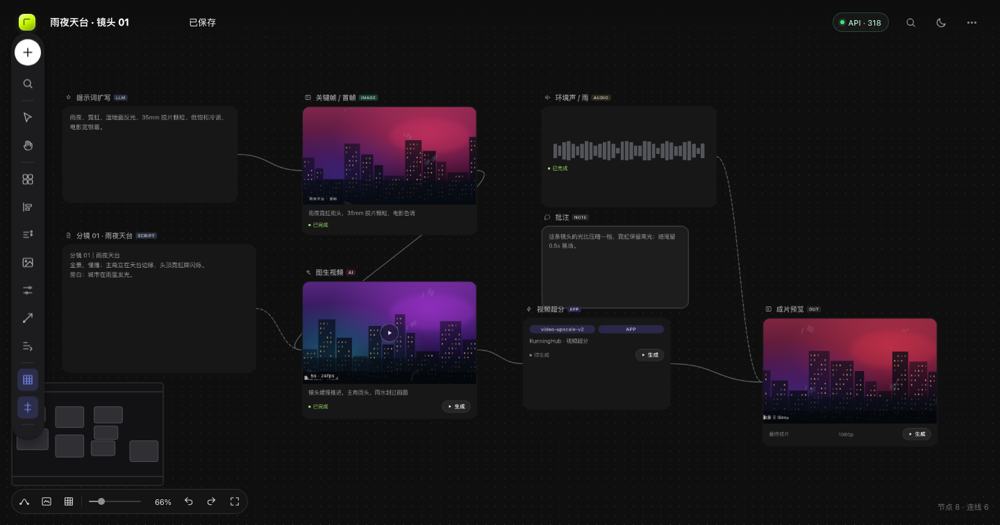
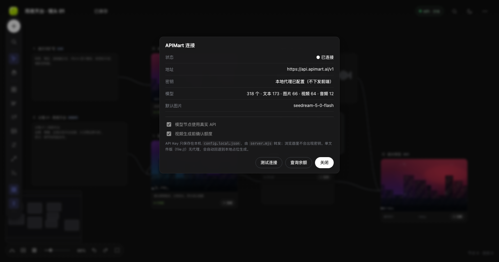
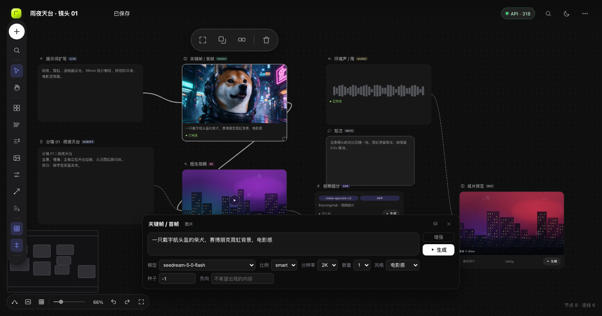

### 10.5 运行

```bash
cd infinite-canvas
./start.sh            # http://127.0.0.1:8099/
# 或指定端口
./start.sh 8100
```

> ⚠️ 密钥安全：key 曾在对话中明文出现。本仓库只把它放在本地 `config.local.json`
> （不上传、不下发前端）；如这段对话会被分享，建议到 APIMart 控制台**轮换该 key**。
> 也可改用环境变量：`APIMART_API_KEY=sk-... ./start.sh`。

---

## 11. 第七轮：模型能力排查 + 节点智能选模型

需求：图片节点只能用「能出图」的模型，视频节点只能用「能出视频」的模型，
文本节点只能用「能出文本」的模型。之前靠模型名前缀猜，会混进不能生成该媒体的模型，
所以改用 **APIMart 官方模型元数据**做权威排查。

### 11.1 数据源（关键发现）

文档里的 *Models List Metadata API*：

```bash
GET /v1/models?expand=parameters&category=image|video|chat|audio
```

返回每个模型的：

- `category`：平台权威分类 `chat / image / video / audio / unknown`
- `capability_tags`：如 `Text to Image`、`Image to Image`、`Text to Video`、`Image to Video`
- `parameters`：JSON Schema（`operation` / `endpoint` / `input_schema.properties`）

排查脚本：[`scripts/audit-models.mjs`](../scripts/audit-models.mjs)（可重复执行，带离线缓存）：

```bash
node scripts/audit-models.mjs
# 生成 src/model-catalog.js（前端静态兜底）+ docs/model-audit.md（排查报告）
```

### 11.2 排查结果（318 个模型）

| 节点类型 | 可用模型 | 说明 |
| --- | ---: | --- |
| 图片 | **53** | 全部为 `image_generation`，其中 **29** 个支持参考图（图生图/图片编辑） |
| 视频 | **57** | 全部为 `video_generation`，其中 **33** 个支持首帧/参考图（图生视频） |
| 文本 | **181** | 179 个正式 `chat` + 2 个未归类但属 chat 家族的兜底（deepseek-v3.1 / qwen3.6-max） |
| 音频 | **9** | TTS + 音乐生成（剔除 whisper/转写类） |
| 其他 | 4 | 未归类且非 chat（如 text-ada-001 类 legacy completions） |

排除的 14 个模型（原因见报告）：babbage / davinci、embedding 3 个、moderation 2 个、
transcribe 2 个、whisper、ocr、audio-preview 2 个等。

对比旧前缀猜法：图片 66 → 实际 53、视频 64 → 57、文本 173 → 181、音频 12 → 9，
说明"名字里带 image/video"并不等于"能生成该媒体"。

### 11.3 智能选择规则

1. 候选池 = 节点类型对应的 `category`（不在池里的模型**不会出现在下拉框**）。
2. 有上游图片/首帧时：图片只列支持 `Image to Image` 的 29 个，视频只列支持
   `Image to Video` 的 33 个；无参考图时列全部。
3. 推荐排序：能力匹配 → 内置"快/省/稳"优先表 → 字母序。
   默认：图片 `seedream-5-0-flash`、视频 `seedance-2.0-mini`、
   文本 `gemini-2.5-flash-lite`、音频 `tts-1`。
4. 自动纠偏：当前模型不属于该类别 / 不支持参考图时，打开面板即自动切换并提示。
5. 运行前二次校验：模型类别和节点不匹配时直接拒绝，不会把请求发给错误端点。
6. 参数面板显示能力标签（文生图 / 图生图 / 图生视频…）与参考图兼容性提示；
   顶部「推荐」按钮可一键回到最优模型。

### 11.4 验证（`tests/models.mjs`，不花钱）

```
catalog counts: text 181 · image 53 · video 57 · audio 9 · other 4
category pure : image/video/text/audio 全部通过
recommend     : 图 seedream-5-0-flash · 视 seedance-2.0-mini · 文 gemini-2.5-flash-lite · 音 tts-1
ref filtering : image 53→29（全部支持参考图）· video 57→33（全部支持首帧）
image node    : 53 个选项 · 无视频模型 · 误选 kling-v3 自动纠正
video node    : 33 个选项 · 全部支持参考图 · 提示「✓ 支持使用上游图片作为参考」
text node     : 181 个选项 · 无图片/视频/音频模型
audio node    : 9 个选项 · 无视频模型
api panel     : 显示权威分类计数 + 「重新排查模型」
errors        : []
```

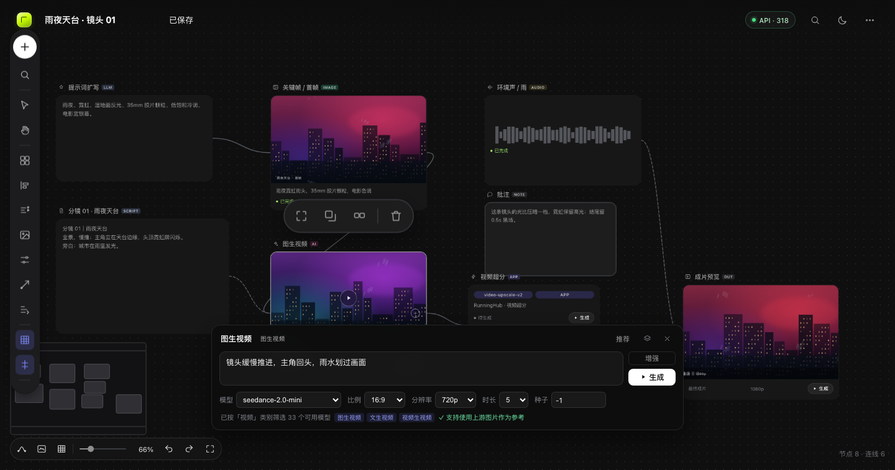
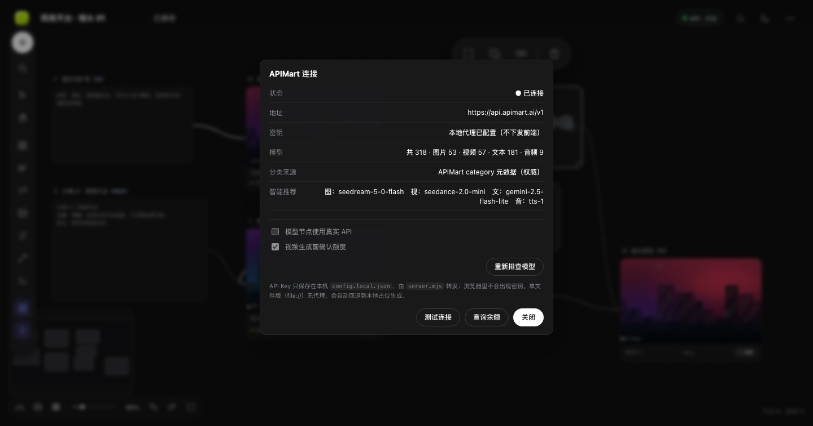

排查明细见 [`docs/model-audit.md`](docs/model-audit.md)（53 + 57 + 181 + 9 张表，含能力标签与参考图支持）。

---

## 12. 交互修复：节点工具条重叠 / 缩小后过大

反馈的两个 UI 问题与修复：

| 问题 | 原因 | 修复 |
| --- | --- | --- |
| 悬停时两条工具条重叠成一个怪胶囊 | 选中态 `.node-toolbar`（聚焦/复制/编组/删除）与悬停态 `.media-toolbar`（下载/复制/翻转/旋转/调整/裁剪/精确编辑/历史/信息/标注）都锚定在节点上方 8–10px 的同一位置 | 选中节点的媒体工具条自动**再抬高一层**（按工具栏实际高度计算），两条垂直堆叠、互不遮挡 |
| 页面缩小后工具条显得过大 | 之前用 `scale(1/zoom)` 反向补偿，工具条恒定为屏幕尺寸，节点缩小时它不缩 | 改为**随画布 zoom 等比缩放**（`clamp(0.4, 1, zoom)`），并把按钮从 28px 收紧到 24px、图标 13px、间距收窄 |

验证（`probe-toolbar`）：在 66% / 35% / 18% 三档缩放下测量两条工具条的包围盒，
`overlap: false` 全部通过；媒体条宽度 189px → 143px → 114px，与节点尺寸保持同比例。

```
zoom .66 : nodeToolbar 82×21  mediaToolbar 189×20  overlap:false
zoom .35 : nodeToolbar 49×13  mediaToolbar 143×15  overlap:false
zoom .18 : nodeToolbar 49×13  mediaToolbar 114×12  overlap:false
```


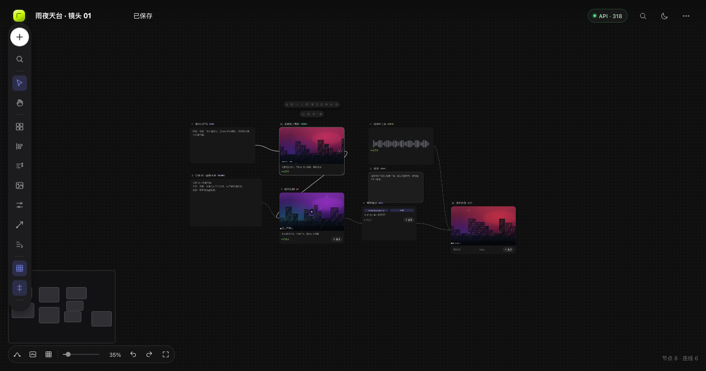

---

## 13. 二次检查：极低缩放下编组工具条尺寸失控

用户在 8% 缩放下选中编组，出现整条彩色色板横贯屏幕、压住标题栏的问题。
排查后确认根因与上一轮同类，但漏了 **编组工具条 / 调整浮层**：

| 问题 | 根因 | 修复 |
| --- | --- | --- |
| 极小缩放时编组工具条被放大十几倍 | `syncGroupToolbar` 仍在用 `scale(1/zoom)`；zoom=0.08 时 scale≈12.5，16px 色板变成 200px | 统一改用 `canvas.uiScale() = clamp(0.4, 1, zoom)`，与节点/媒体工具条一致 |
| 编组在视口外时工具条一半在屏幕外 | 只按编组中心定位，没有边界约束 | 新增 `safeToolbarLeft/Top`：左右贴边、顶部不压标题栏 |
| 颜色调整浮层同样会被反向放大 | 仍是 `1/zoom` | 同样改用 `uiScale()` |

并加了自动化边界检查（`probe-uicheck`）：在 **1.4 / 1 / 0.66 / 0.35 / 0.2 / 0.07** 六档缩放下，
分别测量选中节点（含悬停媒体条）和选中编组时的三条工具条包围盒，检查：

- 宽度不超过视口 70%
- 顶部不低于标题栏（y ≥ 60）
- 左右不超出视口

结果全部 `OK`（修复前 zoom 1.4/1 时编组条 `x=-539`、`x=-243` 直接跑到屏幕外；zoom 0.08 时宽度 446px+ 且被放大）。

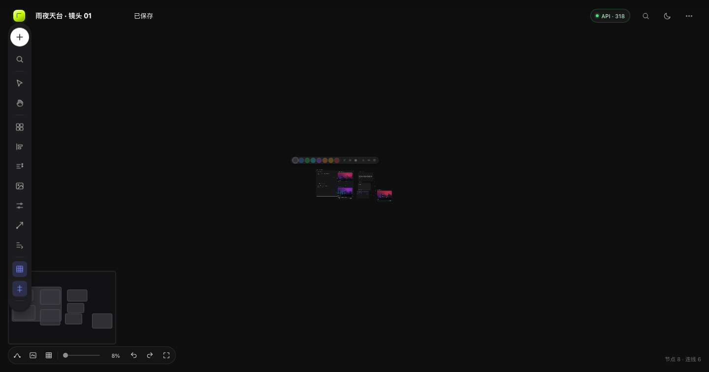
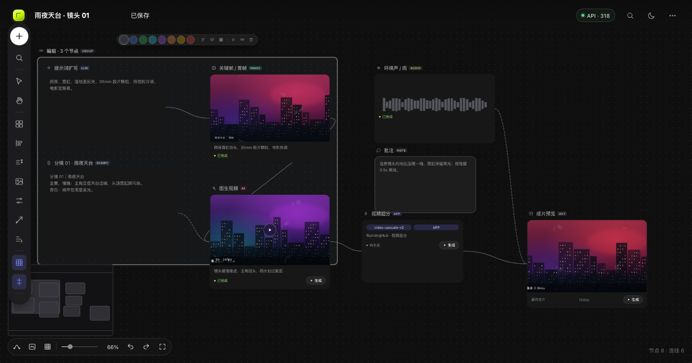

---

## 14. 交互改版：双击预览 / Shift 框选 / 空白关闭弹窗 / 标注二次编辑

| 需求 | 原行为 | 现行为 |
| --- | --- | --- |
| 打开节点生成的内容 | 单击媒体就弹预览，容易误触 | **双击节点（生成内容区域）** 打开预览；单击只选中/拖动。双击标题栏仍打开参数面板 |
| 框选节点 | 普通拖拽即框选，且相交就算选中 | **Shift + 拖拽**框选；**只有完整框住的节点**才被选中（部分重叠不算）。普通拖拽改为平移画布，空格/手型工具仍可平移 |
| 关闭弹窗 | 参数面板等只能点 × 或 Esc | **点击画布空白区域**关闭所有浮层：参数面板、菜单、媒体信息、历史、整理提示、API 面板、素材库、队列等 |
| 箭头二次调整 | 只能新建/清空 | 单击选中（显示首尾两个手柄）→ 拖手柄改长度/方向，拖线身整体移动；Delete 或工具条删除按钮单独删除 |
| 文字二次调整 | 只能新建/清空 | 单击选中（虚线选框）→ 拖动移动；**双击进入改写**（预填原文字）；工具条新增**字号**（14/18/20/24/32/48）；颜色色板对选中标注生效；可单独删除 |

实现要点：

- 标注交互走 capture 阶段（标注层要压过节点），因此原生 `dblclick` 会被 cancel，
  文字的双击改为「两次落点间隔 <420ms 且没有拖动位移」识别，避免"点一下再拖"被误判成双击。
- 标注的选中/拖拽/端点调整都在 `annotation-drag` 交互里完成，`pointerup` 才写一次 undo 快照。
- 文字命中检测用真实渲染包围盒（SVG `getBoundingClientRect`），箭头用点到线段距离（阈值随 zoom 缩放）。

### 14.1 验证（`tests/interactions2.mjs`）

```
blank closes : 参数面板 open=true → 点空白后 hidden=true
preview dbl  : 单击打开=false · 双击打开=true
shift box    : 完整框选 2 个节点 · 只盖住一半时选中 0 个
arrow edit   : 选中后 2 个端点手柄 · 拖头部坐标改变=true · Delete 后箭头数 0
text edit    : 单击选中=true · 拖动移动=true · 双击预填原文 · 改字成功 · 字号 32
errors       : []
```

回归：`interactions / ui / skin / app-level / features / jobs / local-tools / models` 全绿。

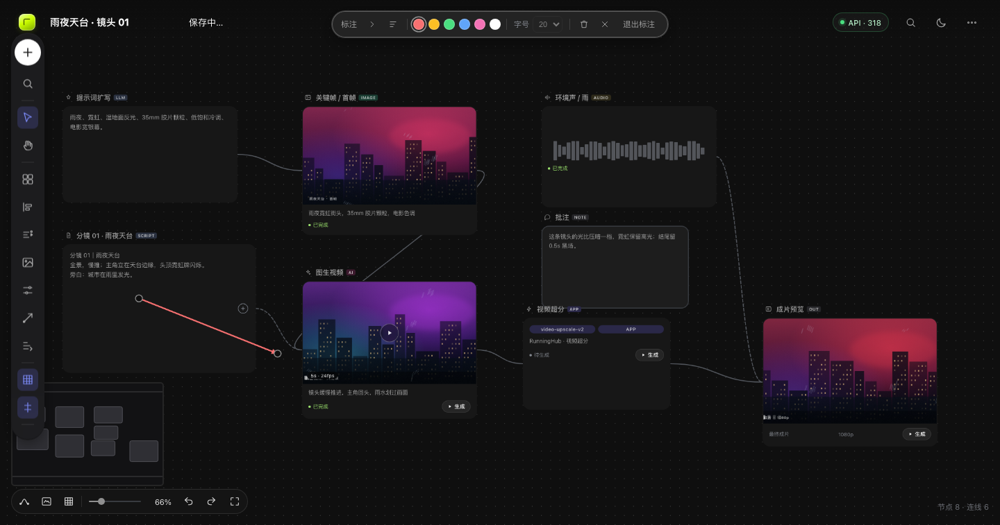

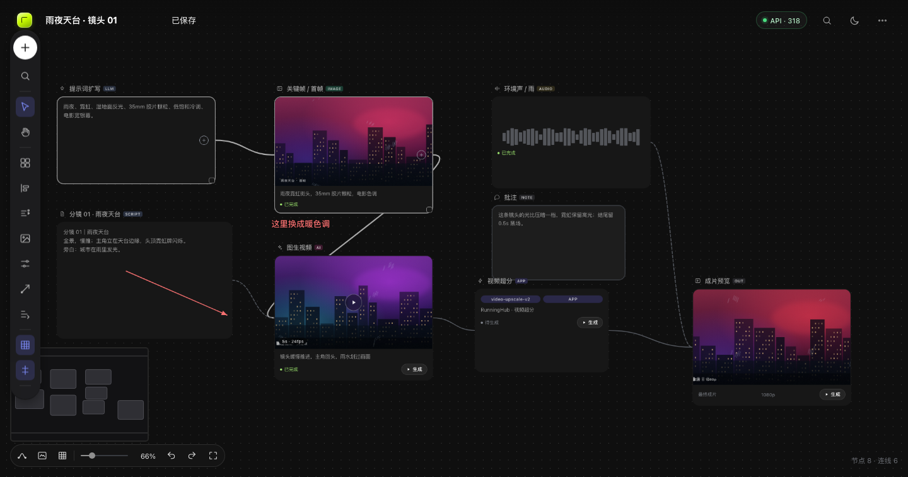

---

## 15. 修复：标注工具条挤压变形

反馈：工具条上"标注""退出标注"竖排换行、颜色圆圈被压成椭圆。

根因有两条：

1. `.annotate-bar` 用 `left:50% + translateX(-50%)` 且没有显式宽度，绝对定位元素在
   `left:50%` 之后可用宽度只剩容器的一半，内容超过一半视口就自动换行；
2. flex 子项默认 `flex-shrink:1`，宽度不足时 17px 的色板被压扁成椭圆，文字也换行。

修复：

- 工具条改为 `width: max-content` + `max-width: calc(100vw - 24px)`，
  不再受 50% 可用宽度限制；
- `flex-wrap: nowrap; white-space: nowrap;`，所有按钮/分隔线/色板 `flex: 0 0 auto`，
  色板固定 17×17 圆形（`box-sizing: border-box`），字号下拉固定 62px；
- 视口过窄时工具条允许横向滚动（隐藏滚动条），而不是换行；
- `@media (max-width: 1080px)` 时工具条下移到标题栏下方（`top:64px`），不压标题/API 胶囊。

验证（`probe-annotbar`，六档视口）：

```
1440px: w=477 h=40 scrollW=475 色板 17×17 ×6 不越界
1024px: w=477 h=40 色板 17×17 ×6 不越界
 900px: w=477 h=40 色板 17×17 ×6 不越界
 820px: w=477 h=40 色板 17×17 ×6 不越界（工具条下移到标题栏下方）
 640px: w=477 h=40 色板 17×17 ×6 不越界
 480px: w=456 h=40 scrollW=475（横向滚动）色板 17×17 ×6 不越界
```

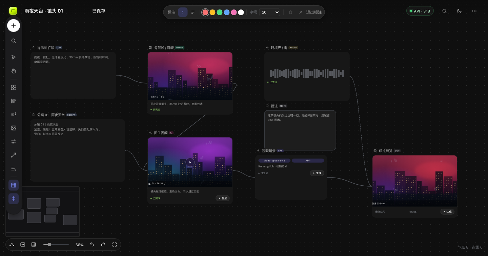
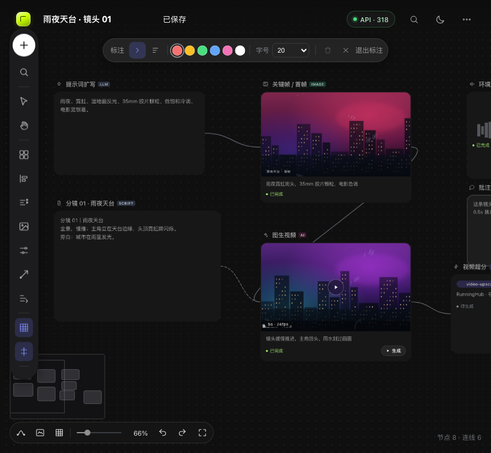

---

## 16. 修复：生成中的白框被误认为选中 / 空白点击取消选择

反馈："这个节点为什么一直有一个白框？点击空白区域要取消所有节点的选择。"

排查结论：

1. **空白点击其实已经会取消选择**（实测 `selection.size: 1 → 0`，`.is-selected` 全部移除）。
   截图里的白框不是选中框，而是**生成中状态框**：
   `.node.is-running .node__card { border-color: rgba(255,255,255,.28) }`，
   颜色和选中灰框（`#8f8f8f`）太接近，视觉上分不出来。
2. 如果请求挂起/刷新后残留 `status: "running"`，这个白框就会一直存在。

修复：

| 问题 | 修复 |
| --- | --- |
| 生成中白框与选中框混淆 | 生成中改为**琥珀色脉冲边框 + 柔光**（`#fbbf24`）；排队中为琥珀色虚线；选中保持灰色并加 1px 外环，二者一眼可分 |
| 生成中 + 选中叠两层框 | 加 `.is-running.is-selected` / `.is-queued.is-selected` 覆盖，只显示状态色 |
| 刷新后残留 running 导致"永远在生成" | 载入/导入时 `normalizeNodeStatuses()` 把 `running/queued` 统一归一为 `idle` |
| 请求挂起导致任务永远不结束 | 前端 API 单次请求加 **120s AbortSignal 超时**；任务轮询本身已有 15min 上限 |
| 标注模式下点空白不清节点选择 | capture 分支里补 `store.clearSelection()` |

验证（`tests/interactions2.mjs` 新增段）：

```
selection/status: { selAfterClick: 1, selAfterBlank: 0, running: true, selected: false, amber: true }
```

另：把 `status: running` 写入 localStorage 后刷新，音频节点状态读回为 `idle`（不再残留白框）。

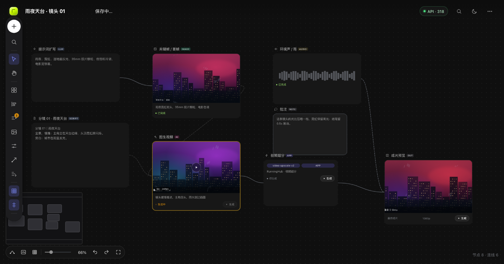
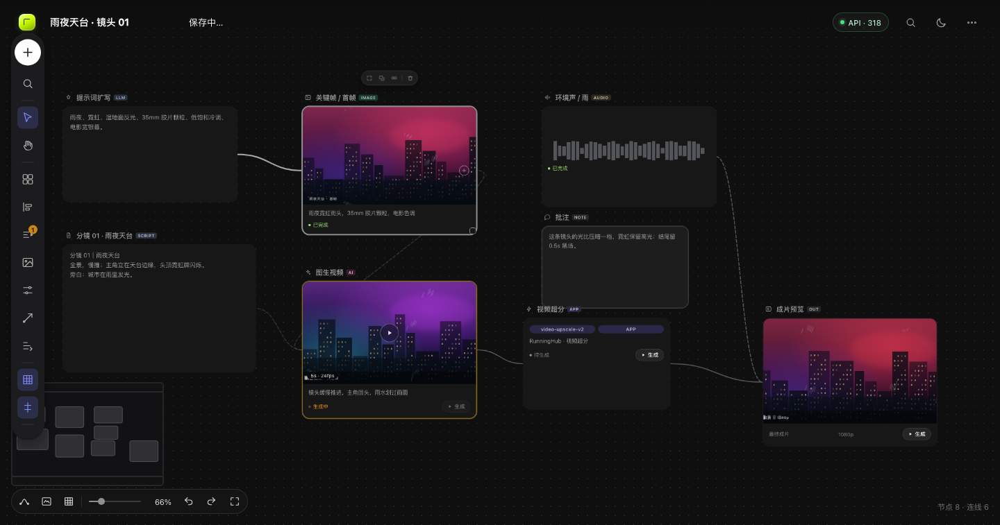
